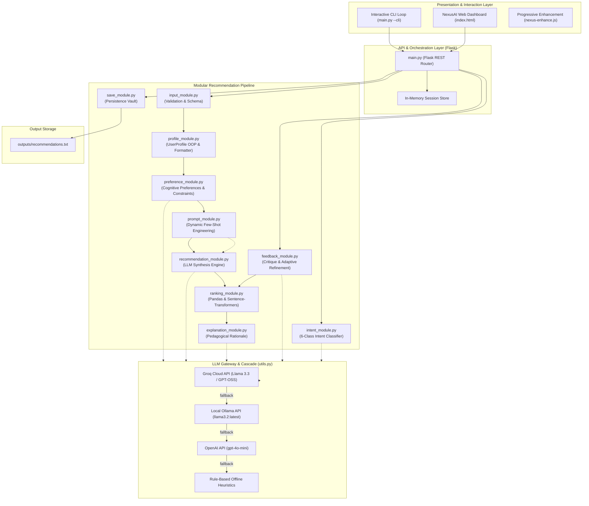

# NexusAI — Personalized Recommendation System (GPT-4 / LLMs)

[](https://www.python.org/)
[](https://flask.palletsprojects.com/)
[](https://groq.com/)
[](https://www.sbert.net/)
[](#academic-alignment)

> **24CS2506 — Building Applications using GPT-4**  
> **Experiment 4:** Design and develop a personalized recommendation system using GPT-4 that collects user information and preferences, analyzes requirements, generates personalized recommendations, ranks them according to suitability, provides explanations, accepts user critique, and refines results continuously.

---

## Table of Contents

- [Overview](#overview)
- [System Architecture & Workflow](#system-architecture--workflow)
- [Key Features](#key-features)
- [Modular Design](#modular-design)
- [Project Directory Structure](#project-directory-structure)
- [Tech Stack & Prerequisites](#tech-stack--prerequisites)
- [Installation & Setup](#installation--setup)
- [Usage Instructions](#usage-instructions)
  - [1. Modern Web Dashboard Mode](#1-modern-web-dashboard-mode-recommended)
  - [2. Terminal Interactive CLI Mode](#2-terminal-interactive-cli-mode)
- [Lab Assignment (Q1 – Q10) Mapping](#lab-assignment-q1--q10-mapping)
- [Lab Record Screenshots Guide (12 Required Views)](#lab-record-screenshots-guide-12-required-views)
- [REST API Endpoints Reference](#rest-api-endpoints-reference)
- [Sample Outputs Audit](#sample-outputs-audit)
- [Troubleshooting & Windows Tips](#troubleshooting--windows-tips)

---

## Overview

Traditional recommendation algorithms rely on collaborative or content-based heuristics that struggle with cold starts and cannot articulate *why* a particular item was suggested. **NexusAI** is an intelligent, multi-provider recommendation engine combining **GPT-4 / Large Language Models (LLMs)** with dense vector semantic embeddings ([`sentence-transformers`](https://www.sbert.net/)) and structured tabular ranking ([`pandas`](https://pandas.pydata.org/)).

The system accepts rich student profiles, deduces pedagogical constraints, formulates specialized system prompts, synthesizes ranked educational recommendations with individual rationale, explains selections interactively, accepts natural language feedback to refine results, and classifies user intents into 6 canonical states.

---

## System Architecture & Workflow



---

## Key Features

1. **Structured Profile Capture:** Normalizes Name, Age, Background, Interests, Skill Level, Preferred Delivery Format, Learning Goal, and Batch Size.
2. **Cognitive Preference & Constraint Extraction:** Analyzes primary and secondary interest vectors and pedagogical boundaries via LLM with deterministic fallbacks.
3. **Structured Prompt Formulation:** Real-time generation of canonical few-shot GPT-4 prompt templates with in-browser copy functionality.
4. **LLM Recommendation Synthesis:** Invokes Groq Cloud (`llama-3.3-70b-versatile` / `openai/gpt-oss-120b`), Ollama, or OpenAI to return clean JSON candidate recommendations.
5. **Pandas & Sentence-Transformers Hybrid Ranking:** Ranks items by suitability score using Pandas; optionally blends scores with dense vector semantic cosine similarity.
6. **Individual Pedagogical Explanations:** Dedicated modal dialogs and CLI commands that explain why an item fits the learner's background.
7. **Iterative Critique & Refinement:** Ingests user feedback (e.g. *"Prefer AI and do not want Web Development"*), excludes negative constraints, and recalculates the curriculum.
8. **Autonomous Intent Decoding:** Real-time classification of natural language queries into 6 canonical intents (`GENERATE_RECOMMENDATION`, `REFINE_RECOMMENDATION`, `SHOW_PROFILE`, `EXPLAIN_RECOMMENDATION`, `SAVE_RECOMMENDATION`, `EXIT`).
9. **Full Session Persistence:** Exports a comprehensive audit report to `outputs/recommendations.txt` with in-browser inspection and direct file download.
10. **Dual Interface:** Full-featured Web UI with a cybernetic dark theme and an interactive terminal CLI loop.

---

## Modular Design

| File | Module Name | Lab Part | Core Responsibility |
|---|---|---|---|
| [`input_module.py`](RecommendationSystem/input_module.py) | **Input Module** | Part A (Q1) | Captures, parses, and validates user inputs with strict schema checks and CLI defaults. |
| [`profile_module.py`](RecommendationSystem/profile_module.py) | **Profile Module** | Part A (Q2) | `UserProfile` OOP class with clean ASCII formatted output matching the lab spec. |
| [`preference_module.py`](RecommendationSystem/preference_module.py) | **Preference Module** | Part B (Q3) | Extracts primary/secondary anchors and synthesizes pedagogical constraints. |
| [`prompt_module.py`](RecommendationSystem/prompt_module.py) | **Prompt Module** | Part C (Q4) | Constructs initial prompts, refinement templates, and explanation prompts. |
| [`recommendation_module.py`](RecommendationSystem/recommendation_module.py) | **Recommendation Module** | Part D (Q5) | Invokes LLM, parses JSON, and normalizes candidate items. |
| [`ranking_module.py`](RecommendationSystem/ranking_module.py) | **Ranking Module** | Part E (Q6) | Tabulates and sorts recommendations via Pandas with optional vector embeddings. |
| [`explanation_module.py`](RecommendationSystem/explanation_module.py) | **Explanation Module** | Part F (Q7) | Produces individual and batch pedagogical rationale for recommendations. |
| [`feedback_module.py`](RecommendationSystem/feedback_module.py) | **Feedback Module** | Part G (Q8) | Refines recommendations based on user feedback and exclusion constraints. |
| [`intent_module.py`](RecommendationSystem/intent_module.py) | **Intent Module** | Part H (Q9) | Classifies user queries into 6 canonical intent categories. |
| [`save_module.py`](RecommendationSystem/save_module.py) | **Save Module** | Part I (Q10) | Writes comprehensive session reports to `outputs/recommendations.txt`. |
| [`utils.py`](RecommendationSystem/utils.py) | **Utilities Module** | Foundation | Multi-provider LLM gateway, fallback cascade, JSON cleaner, and Windows CP1252 text sanitizer. |
| [`main.py`](RecommendationSystem/main.py) | **Main Orchestrator** | Integration | Dual-mode launcher: Flask REST API server and continuous interactive CLI loop. |

---

## Project Directory Structure

```text
Ex4/
│
├── .env                              # Active environment configuration & API keys
├── .env.example                      # Template environment variables
├── .gitignore                        # Git exclusion rules
├── README.md                         # Project documentation
├── requirements.txt                  # Python dependencies
│
└── RecommendationSystem/
    ├── __init__.py                   # Package initialization
    ├── input_module.py               # Q1: User input validation & ingestion
    ├── profile_module.py             # Q2: Profile representation & display
    ├── preference_module.py          # Q3: Preference & constraint analysis
    ├── prompt_module.py              # Q4: Structured prompt construction
    ├── recommendation_module.py      # Q5: LLM recommendation generation
    ├── ranking_module.py             # Q6: Pandas ranking & vector similarity
    ├── explanation_module.py         # Q7: Pedagogical explanation generator
    ├── feedback_module.py            # Q8: Feedback critique & list refinement
    ├── intent_module.py              # Q9: 6-Class intelligent intent detection
    ├── save_module.py                # Q10: Audit persistence to text file
    ├── utils.py                      # Multi-provider LLM connector & text cleaners
    ├── main.py                       # Master dual launcher (Web API + CLI loop)
    │
    ├── models/                       # Local embeddings cache directory
    ├── outputs/
    │   └── recommendations.txt       # Generated recommendation reports
    │
    ├── static/
    │   ├── css/
    │   │   ├── style.css             # Core design system & layout tokens
    │   │   └── nexus-enhance.css     # Progressive enhancement styles
    │   ├── js/
    │   │   ├── app.js                # Full client application controller
    │   │   └── nexus-enhance.js      # Accessible ARIA, modals, spotlight effects
    │   └── images/
    │
    └── templates/
        └── index.html                # Modern single-page web dashboard
```

---

## Tech Stack & Prerequisites

- **Language:** Python 3.10+
- **Web Framework:** Flask 3.0+
- **Data & Ranking:** Pandas 2.0+, Sentence-Transformers 3.0+
- **LLM Integrations:**
  - **Groq Cloud API** (`llama-3.3-70b-versatile` / `openai/gpt-oss-120b`)
  - **Local Ollama** (`llama3.2:latest`)
  - **OpenAI API** (`gpt-4o-mini`)
- **Frontend:** Vanilla HTML5, CSS3 (Glassmorphism, Cybernetic Mesh), JavaScript (ES6+), Lucide Icons CDN

---

## Installation & Setup

### 1. Clone or Open Workspace
```powershell
cd "c:\Users\shiro\OneDrive\Desktop\Education\4th Year\GPT-4\Ex4"
```

### 2. Install Required Python Dependencies
```powershell
pip install -r requirements.txt
```

### 3. Configure Environment Variables
Copy `.env.example` to `.env` if not already present:
```powershell
Copy-Item .env.example .env
```
Edit `.env` to select your preferred LLM provider:
```ini
# LLM Configuration (Options: groq, ollama, openai)
DEFAULT_LLM_PROVIDER=groq

# Groq Cloud Configuration (Recommended: Free & Fast)
GROQ_API_KEY=gsk_your_groq_api_key_here
GROQ_MODEL=llama-3.3-70b-versatile

# Local Ollama Fallback (Offline & Free)
OLLAMA_BASE_URL=http://localhost:11434
OLLAMA_MODEL=llama3.2:latest

# Application Settings
FLASK_ENV=development
PORT=5000
```

> **Note:** If no API keys are provided or the network is unavailable, the system automatically uses structured offline fallbacks based on your profile inputs.

---

## Usage Instructions

### 1. Modern Web Dashboard Mode (Recommended)

Launch the Flask development server:
```powershell
python RecommendationSystem/main.py
```
Open your browser and navigate to:
```
http://127.0.0.1:5000
```

#### Web Dashboard Highlights:
- **Hero Section:** Live pipeline status indicator and interactive inference graph.
- **Learner Profile Studio:** Form input with quick-tag interest chips (ML, Deep Learning, Generative AI).
- **Dual Tabbed Preview:** View the active validated profile, extracted pedagogical constraints, and generated GPT-4 prompt.
- **Generate & Rank:** One-click recommendation synthesis with real-time suitability scoring.
- **Explanation Modal:** Click *"Why this?"* on any card to view detailed rationale.
- **Continuous Feedback:** Refine results with preset critique pills (e.g. *"Exclude Web Development"*) or custom feedback.
- **Cognitive Intent Console:** Natural language command terminal to decode intent and trigger actions.
- **Save to File:** Export results to `outputs/recommendations.txt` with in-browser inspection.

---

### 2. Terminal Interactive CLI Mode

Run the continuous command loop in your terminal:
```powershell
python RecommendationSystem/main.py --cli
```

#### CLI Interaction Walkthrough:
1. **Profile Input:** Prompts for Name, Age, Background, Interests, Skill Level, Preference, Goal, and Item Count. Press `[Enter]` to accept sample defaults (`Arun`, `Computer Science`, `AI/Python`, etc.).
2. **Analysis & Prompt:** Displays the profile, preference analysis, and constructed prompt.
3. **Generation & Leaderboard:** Generates recommendations and displays the ranked table.
4. **Continuous Command Loop:** Enter natural language queries or commands:
   - `Recommend more courses` &rarr; `GENERATE_RECOMMENDATION`
   - `I prefer AI and do not want Web Dev` &rarr; `REFINE_RECOMMENDATION`
   - `Why did you recommend this course?` &rarr; `EXPLAIN_RECOMMENDATION`
   - `Show my profile` &rarr; `SHOW_PROFILE`
   - `Save recommendations` &rarr; `SAVE_RECOMMENDATION`
   - `Exit` &rarr; `EXIT`

---

## Lab Assignment (Q1 – Q10) Mapping

| Lab Question | Objective | Module Implementation |
|---|---|---|
| **Part A (Q1)** | Read User Profile Details | [`input_module.py: validate_user_input()`](RecommendationSystem/input_module.py) |
| **Part A (Q2)** | Display Collected Information Neatly | [`profile_module.py: UserProfile.display()`](RecommendationSystem/profile_module.py) |
| **Part B (Q3)** | Analyze User Profile & Extract Preferences | [`preference_module.py: analyze_preferences()`](RecommendationSystem/preference_module.py) |
| **Part C (Q4)** | Construct Suitable GPT-4 Prompt | [`prompt_module.py: construct_initial_prompt()`](RecommendationSystem/prompt_module.py) |
| **Part D (Q5)** | Generate Personalized Recommendations | [`recommendation_module.py: generate_recommendations()`](RecommendationSystem/recommendation_module.py) |
| **Part E (Q6)** | Rank Recommendations (Suitability Score) | [`ranking_module.py: rank_recommendations()`](RecommendationSystem/ranking_module.py) |
| **Part F (Q7)** | Generate Recommendation Explanation | [`explanation_module.py: explain_single_item()`](RecommendationSystem/explanation_module.py) |
| **Part G (Q8)** | User Feedback & Recommendation Refinement | [`feedback_module.py: refine_recommendations()`](RecommendationSystem/feedback_module.py) |
| **Part H (Q9)** | Intelligent Intent Detection (6 Intents) | [`intent_module.py: detect_intent()`](RecommendationSystem/intent_module.py) |
| **Part I (Q10)**| End-to-End System, Loop & File Persistence | [`save_module.py`](RecommendationSystem/save_module.py) & [`main.py`](RecommendationSystem/main.py) |

---

## Lab Record Screenshots Guide (12 Required Views)

As specified in [`LAB RECORD-4.pdf`](file:///C:/Users/shiro/Downloads/LAB%20RECORD-4.pdf#L2), the following 12 screenshots are required for lab submission:

1. **Home Screen:** The top hero section showing the banner, live architecture preview, and navigation bar.
2. **User Profile Input:** The *Learner Profile Specification* form filled with profile details.
3. **Collected User Profile:** The *Active Profile* tab card showing normalized values.
4. **Preference Analysis:** The *Cognitive Analysis* tab showing primary/secondary anchors and constraints.
5. **Prompt Generation:** The *Formulated Prompt* tab showing the generated GPT-4 markdown prompt.
6. **GPT-4 Recommendation:** The *Synthesized Candidates* cards displaying items, scores, and reasons.
7. **Recommendation Ranking:** The *Suitability Ranking Leaderboard* table showing ranks, names, and scores.
8. **Recommendation Explanation:** The *Recommendation Analysis* modal dialog opened after clicking *"Why this?"*.
9. **User Feedback:** The *Continuous Feedback & Iterative Refinement* card with feedback entered.
10. **Refined Recommendations:** The *Refined Recommendation Output* drawer showing updated recommendations.
11. **Intent Detection:** The *Autonomous Cognitive Intent Decoder* console showing the detected intent tag and classification rationale.
12. **Recommendation Saved Successfully:** The confirmation banner showing the file path, plus the opened *File Inspector* modal displaying `outputs/recommendations.txt`.

---

## REST API Endpoints Reference

| Endpoint | Method | Payload / Params | Description |
|---|---|---|---|
| `/` | `GET` | — | Serves the single-page application dashboard. |
| `/api/config` | `GET` | — | Returns active LLM provider, models, and API key status. |
| `/api/profile` | `POST` | JSON Profile Object | Validates inputs, builds profile, analyzes preferences, constructs prompt. |
| `/api/generate` | `POST` | — | Invokes LLM, ranks candidates, and stores results in session. |
| `/api/explain` | `POST` | `{"item_name": "...", "reason": "..."}` | Generates pedagogical explanation for a specific item. |
| `/api/feedback` | `POST` | `{"feedback": "..."}` | Refines recommendations based on user critique. |
| `/api/intent` | `POST` | `{"query": "..."}` | Classifies natural language text into one of 6 canonical intents. |
| `/api/save` | `POST` | — | Writes current session report to `outputs/recommendations.txt`. |
| `/api/view-saved` | `GET` | — | Returns raw text content of `outputs/recommendations.txt`. |
| `/api/download-saved`| `GET` | — | Direct browser attachment download of the output report. |

---

## Sample Outputs Audit

Below is an excerpt from a generated report in [`outputs/recommendations.txt`](RecommendationSystem/outputs/recommendations.txt):

```text
============================================================
PERSONALIZED RECOMMENDATION SYSTEM REPORT
24CS2506 - Building Applications using GPT-4 | Experiment 4
Generated At: 2026-10-15 17:16:55
============================================================

-----------------------------------
COLLECTED USER PROFILE
-----------------------------------
Name         : Deepak Krishnan S U
Age          : 21
Background   : Computer Science
Interests    : Artificial Intelligence, Python, Java, Generative AI, Deep Learning, Machine Learning
Skill Level  : Intermediate
Preference   : Practical learning
Goal         : Learn AI
No. of Items : 10
-----------------------------------

Preference Analysis
------------------------------
Primary Interest   : Artificial Intelligence
Secondary Interest : Python
Skill Level        : Intermediate
Goal               : Learn AI
Preference         : Practical learning
Constraints        : Structured for hands-on, code-first immersion with zero excessive math overhead.
------------------------------

RECOMMENDATION RANKINGS
Rank | Recommendation                 | Score
----------------------------------------------
1    | AI For Everyone (Coursera) ... | 96%
2    | Deep Learning Fundamentals ... | 94%
3    | Generative AI with Python: ... | 92%
4    | Machine Learning Crash Cour... | 90%
5    | Intro to AI with Java (Plur... | 88%
...
----------------------------------------------

USER FEEDBACK & REFINEMENT:
------------------------------------------------------------
Feedback Received: "Give me more beginner-friendly, visual video courses."

Refined Recommendations:
1. AI For Everyone (Coursera) - Andrew Ng (Score: 96%)
   Reason: Short, highly visual video series explaining AI concepts without heavy math.
...
============================================================
End of Report
============================================================
```

---

## Troubleshooting & Windows Tips

- **Windows Console Encoding:** If running on Windows PowerShell and encountering Unicode errors, [`utils.py`](RecommendationSystem/utils.py) includes `sanitize_text()`, which converts fancy quotes and dashes to ASCII equivalents.
- **Port Conflicts:** If port `5000` is occupied, specify an alternate port:
  ```powershell
  python RecommendationSystem/main.py --port 8080
  ```
- **Sentence-Transformers Download:** The first time semantic scoring runs, `sentence-transformers` downloads `all-MiniLM-L6-v2` (~80MB). If offline, the system automatically falls back to Pandas score sorting.

---

## Academic Alignment & Credits

- **Course:** 24CS2506 — Building Applications using GPT-4
- **Curriculum:** B.Tech Computer Science and Engineering (AI & Data Science)
- **Experiment:** Ex. No. 4: Personalized Recommendation System
- **Developed by:** Deepak Krishnan S U
